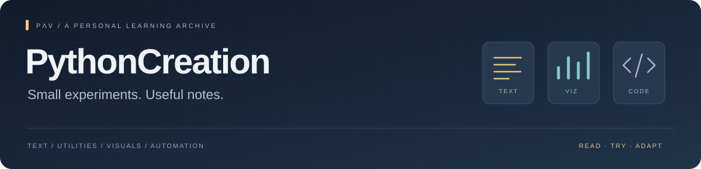

<div align="center">

[简体中文](README.md) · **English**



### Small experiments. Useful notes. A record of learning by doing.

[Browse by purpose](#browse-by-purpose) · [Start here](#start-here) · [Before running](#before-running) · [PΛV's website](https://www.worldai.fun)

</div>

## What this repository is

**PythonCreation is a personal learning archive**, collecting small Python utilities, creative demos, data-visualisation exercises, and older automation / parsing experiments.

It is **not a single application, an installable Python package, or a ready-to-run toolkit**. Folders are independent and retain their original names. Use the index below to find a relevant example, then review that script's inputs, dependencies, and side effects.

> Looking for more structured projects with dedicated setup documentation? See [Practical Toolbox](https://github.com/NanStars/practical-toolbox).

## Browse by purpose

| Area | Directory | What to expect |
| :--- | :--- | :--- |
| **Text & encoding** | [TXT processing](TXT%E5%90%88%E6%88%90/) · [Base64](base64/) · [Text to speech](%E6%96%87%E5%AD%97%E9%98%85%E8%AF%BB/) | Merge TXT files, inspect / convert encodings, decode image data, and read local text aloud. |
| **Small utilities** | [Utilities](%E4%BE%BF%E5%88%A9%E5%B7%A5%E5%85%B7/) | Translation experiments and image-coordinate selection with OpenCV. |
| **Data visualisation** | [Historical dashboard](Epidemic-visualization-main/yiqing/) | An exercise connecting Flask routes, MySQL queries, and ECharts visualisations. |
| **Browser automation** | [Selenium exercises](selenium/) | Legacy examples of browser interaction and file-upload workflows; review compatibility first. |
| **Creative experiments** | [Visual & terminal demos](%E8%8A%B1%E9%87%8C%E8%83%A1%E5%93%A8/) | Code rain, a Turtle Christmas tree, fireworks HTML, countdowns, and progress output. |
| **Parsing & troubleshooting** | [STEAM](STEAM/) · [Historical scraping](%E5%B0%8F%E8%AF%B4%E7%88%AC%E8%99%AB%E9%A1%B9%E7%9B%AE/) · [Troubleshooting notes](%E9%97%AE%E9%A2%98/) | HTML parsing, historical data-collection exercises, and notes on encoding / request errors. |

## Start here

These entries have a relatively clear purpose. They were **reviewed statically for this documentation**, not executed as part of a complete compatibility test.

| Entry | Dependencies | Inputs / effects |
| :--- | :--- | :--- |
| [Ten-second countdown](%E8%8A%B1%E9%87%8C%E8%83%A1%E5%93%A8/%E5%8D%81%E7%A7%92%E5%80%92%E8%AE%A1%E6%97%B6.py) | Standard library | Prints a countdown in the terminal. |
| [Progress-bar output](%E8%8A%B1%E9%87%8C%E8%83%A1%E5%93%A8/%E8%BF%9B%E5%BA%A6%E6%9D%A1.py) | Standard library | Demonstrates terminal progress output; it does not download anything. |
| [Image data-URL decoding](base64/%E5%9B%BE%E7%89%87%E8%A7%A3%E7%A0%81.py) | Standard library | Expects a comma-separated image data URL and writes `33.jpeg`, replacing an existing file. |
| [Select image coordinates](%E4%BE%BF%E5%88%A9%E5%B7%A5%E5%85%B7/%E8%8E%B7%E5%8F%96%E5%9B%BE%E5%83%8F%E5%9D%90%E6%A0%87%E7%82%B9/%E5%9D%90%E6%A0%87%E5%AE%9A%E4%BD%8D.py) | `opencv-python` · `numpy` | Opens a local image and records clicked coordinates; requires a desktop session and at least one click. |
| [Code rain](%E8%8A%B1%E9%87%8C%E8%83%A1%E5%93%A8/%E4%BB%A3%E7%A0%81%E9%9B%A8.py) | `pygame` | A graphical code-rain experiment with a fixed 1920 × 1080 window. |
| [Christmas tree](%E8%8A%B1%E9%87%8C%E8%83%A1%E5%93%A8/%E5%9C%A3%E8%AF%9E%E6%A0%91.py) | `turtle` / Tk support | A drawing exercise; requires a graphical desktop. |

### A minimal terminal example

After cloning and entering the repository, the countdown and progress examples use only the Python standard library:

```bash
git clone https://github.com/NanStars/PythonCreation.git
cd PythonCreation

python "花里胡哨/十秒倒计时.py"
python "花里胡哨/进度条.py"
```

`python` must refer to your Python 3 interpreter. The progress example only prints a visual progress bar; its “Download progress” text is not a real network task.

## Before running

1. **Read the selected script first.** Several files run code immediately at import time; do not batch-run the repository.
2. **Use an isolated environment for third-party dependencies.** There is no repository-wide dependency lock or validated single Python-version target. Install only what the selected example requires.
3. **Check paths and the working directory.** Older examples include machine-specific paths. Relative files such as `1.txt` are resolved from the current working directory, not necessarily beside the script.
4. **Protect your files.** Run file-writing examples on copies. Encoding conversion rewrites source files; TXT merging appends to `合并.txt`, so repeated runs can duplicate output.
5. **Review legacy web integrations.** URLs, selectors, APIs, logins, and browser drivers may no longer match the original environment.

## Notes for larger / historical examples

<details>
<summary><strong>TXT processing & text-to-speech</strong></summary>

- [TXT merging](TXT%E5%90%88%E6%88%90/%E5%90%88%E6%88%90.py) uses a hardcoded input folder and appends output; it does not explicitly sort the directory listing.
- [Encoding inspection](TXT%E5%90%88%E6%88%90/%E7%BC%96%E7%A0%81%E6%9F%A5%E7%9C%8B.py) and [conversion](TXT%E5%90%88%E6%88%90/%E7%BC%96%E7%A0%81%E8%BD%AC%E6%8D%A2.py) use `chardet`. Back up input files before conversion.
- [Text-to-speech examples](%E6%96%87%E5%AD%97%E9%98%85%E8%AF%BB/) use `pyttsx3` and local system voices. The examples expect `1.txt` in the working directory; voice availability depends on the operating system.

</details>

<details>
<summary><strong>Historical visualisation dashboard</strong></summary>

The main pieces are [app.py](Epidemic-visualization-main/yiqing/app.py), [sqldata.py](Epidemic-visualization-main/yiqing/sqldata.py), [spider.py](Epidemic-visualization-main/yiqing/spider.py), templates, and static chart assets.

The example uses Flask, PyMySQL, requests, MySQL, and ECharts. Running the Flask process alone does not supply the required database, tables, connection configuration, or valid data. Historical upstream data interfaces have not been revalidated. Treat this as a visualisation-learning example, **not a current epidemic-statistics service**.

</details>

<details>
<summary><strong>Selenium & historical parsing exercises</strong></summary>

The Selenium folder contains browser-interaction exercises and older site-specific workflows. Some files use legacy Selenium APIs. Do not assume the bundled `chromedriver.exe` files are compatible with your browser or treat old login examples as ready-to-run integrations.

[The STEAM parsing example](STEAM/STEAM_subid/STEAM_DB.py) expects a local `STEAM_DB.html` input that is not included in the repository. Historical scraping examples may depend on changed markup or external services. Review access permissions, request volume, and content rights before adapting any collection workflow.

</details>

## Safety, maintenance & scope

- Keep real passwords, API keys, cookies, database exports, and account state out of public commits. Review and sanitise hardcoded configuration before reuse; rotate any value that was a real credential.
- Some high-risk network experiments are intentionally excluded from the recommended starting points. Do not run network code against systems you do not own or have explicit permission to test.
- The repository also contains historical IDE settings, saved pages, text output, and driver binaries. They are not a complete dependency or deployment package.
- No unified `LICENSE` is currently present. Public visibility does not itself grant unrestricted redistribution or commercial-use rights; check authorship and third-party licences before reuse.

**This refresh changes documentation and the repository introduction only.** It does not move directories, change program logic, execute historical scripts, or claim that all examples still work.

---

<div align="center">

**Read one example. Understand it. Adapt it carefully.**

[PΛV](https://github.com/NanStars) · [Personal website](https://www.worldai.fun) · [Practical Toolbox](https://github.com/NanStars/practical-toolbox)

</div>
